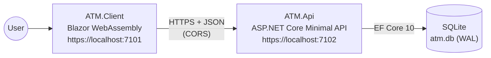
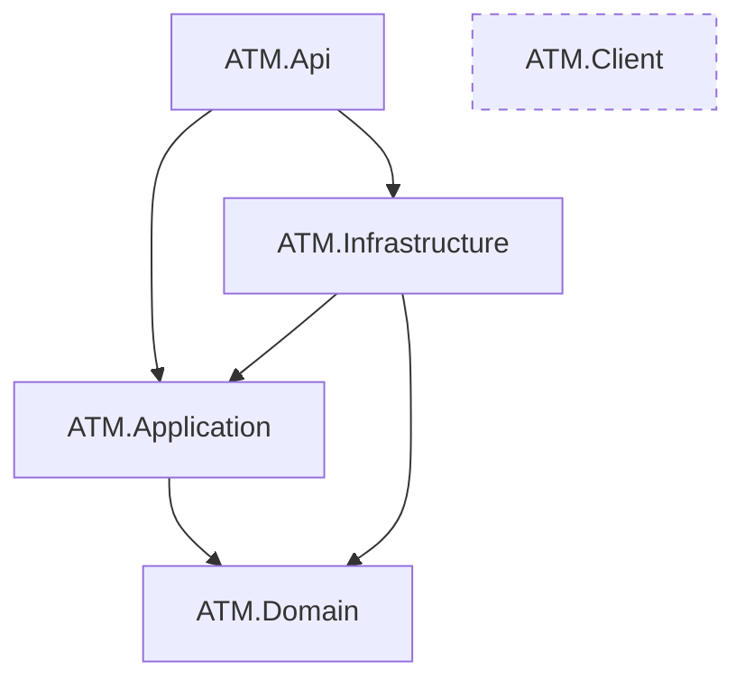
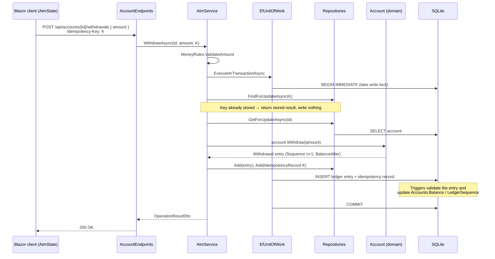

# ATM — Architecture Overview

This document describes the architecture of the ATM solution as it is implemented today: how the projects are layered, how a request flows through them, and how financial correctness is guaranteed.

For setup, running and configuration, see the [README](../../README.md).

---

## 1. System context

The system is two processes and a database file:

- **ATM.Client** runs entirely in the browser. It only talks to the API over HTTPS.
- **ATM.Api** hosts the business logic and is the only process that touches the database.
- **SQLite** is a single file (`atm.db`). It's created, migrated and seeded by the API at startup.

There is no authentication, and no other external dependency.

---

## 2. Solution layout and dependencies

The backend follows Clean Architecture: dependencies point inward, toward the domain.

`ATM.Client` has no project reference to the backend. It keeps its own copies of the DTOs and talks to the API only over HTTP.

| Project | Responsibility | Key types |
|---|---|---|
| `ATM.Domain` | Business entities and rules. No dependencies. | `Account`, `Transaction`, `TransactionType`, `MoneyRules`, domain exceptions |
| `ATM.Application` | Use cases, DTOs and the persistence interfaces they need | `IAtmService` / `AtmService`, `IAccountRepository`, `ITransactionRepository`, `IIdempotencyRepository`, `IUnitOfWork`, `ILedgerReconciliationService`, `IdempotencyRecord`, `AtmMappings` |
| `ATM.Infrastructure` | EF Core + SQLite implementation of those interfaces, migrations, ledger triggers, startup checks | `AtmDbContext`, `EfUnitOfWork`, repositories, `LedgerReconciliationService`, `DatabaseInitializer`, `SqliteConnectionInterceptor`, `MoneyValueConverter` |
| `ATM.Api` | HTTP surface: endpoints, request contracts, error mapping, CORS, OpenAPI | `AccountEndpoints`, `TransferEndpoints`, `GlobalExceptionHandler`, `ExceptionMapper`, `ErrorCodes` |
| `ATM.Client` | Blazor WebAssembly UI, API client and UI state | `Dashboard`, form and account components, `AtmApiClient`, `AtmState` |

Each layer registers its own services through an extension method called from `ATM.Api/Program.cs`: `AddApiServices`, `AddApplication`, `AddInfrastructure`. The client uses `AddClientServices`.

---

## 3. Domain model

### Account

`Account` is the aggregate root. Its setters are private, so a balance can only change through its methods, and **every method that changes the balance returns the ledger entry that records it**:

| Method | Ledger entry returned |
|---|---|
| `Account.Open(name, openingBalance)` | `OpeningBalance` (sequence 1) — the only way to create an account |
| `Deposit(amount)` | `Deposit` |
| `Withdraw(amount)` | `Withdrawal` |
| `Account.Transfer(source, destination, amount)` | `TransferOut` + `TransferIn`, sharing a new `ReferenceId` |

`Account` also tracks `LedgerSequence`, the sequence number of its latest entry. Each new entry gets `LedgerSequence + 1` and records the resulting `BalanceAfter`.

`Transfer` validates both sides (destination limit, source funds) before changing either account.

### Transaction (ledger entry)

A `Transaction` is immutable once created. It holds `AccountId`, `Sequence`, `Type`, `Amount`, `BalanceAfter`, an optional `ReferenceId` (transfers only) and `CreatedAt`.

| `TransactionType` | Value | Effect on balance |
|---|---|---|
| `Deposit` | 1 | + amount |
| `Withdrawal` | 2 | − amount |
| `TransferIn` | 3 | + amount |
| `TransferOut` | 4 | − amount |
| `OpeningBalance` | 5 | sets the balance |

### Money rules

`MoneyRules` is the single source for money validation:

| Rule | Value |
|---|---|
| Currency | `USD` only |
| Amount per operation | `0.01` – `1,000,000` |
| Balance | `0` – `1,000,000,000` |
| Precision | at most 2 decimal places |

Violations raise `InvalidAmountException`, `InsufficientFundsException` or `BalanceLimitExceededException`.

---

## 4. Application layer

`AtmService` implements every use case behind `IAtmService`.

- **Queries** — `GetAccountsAsync`, `GetAccountAsync` and `GetTransactionHistoryAsync` read through the repositories with no-tracking queries and map entities to DTOs.
- **Commands** — `DepositAsync`, `WithdrawAsync` and `TransferAsync` take an idempotency key and all follow the same shape:
  1. Validate the input (`MoneyRules.ValidateAmount`; for transfers, reject source = destination; reject an empty key).
  2. Open a unit of work with `IUnitOfWork.ExecuteInTransactionAsync`.
  3. Look up the key (`IIdempotencyRepository.FindForUpdateAsync`). If it's already stored, return the stored result (same request) or throw `IdempotencyKeyConflictException` (different request), and write nothing.
  4. Load the accounts **for update** (`IAccountRepository.GetForUpdateAsync`, which refuses to run outside a transaction).
  5. Call the domain method, then add the returned ledger entries to `ITransactionRepository`.
  6. Store an `IdempotencyRecord` with the key, the request fingerprint and the serialized result.
  7. Return a result DTO (`OperationResultDto` or `TransferResultDto`) with the updated account(s) and the new entries.

  Steps 3–6 are one transaction, so the record commits only together with the ledger entries. See [section 7a](#7a-idempotency).

The service has no knowledge of EF Core or SQLite. It only depends on the interfaces in `ATM.Application/Interfaces/Persistence`.

---

## 5. Request flow (write operation)

A withdrawal, end to end:

If anything fails, `EfUnitOfWork` rolls back, clears the change tracker and re-throws. The exception is turned into an HTTP error by the API's error handling (section 8).

---

## 6. Persistence

### Schema

| Table | Columns | Notes |
|---|---|---|
| `Accounts` | `Id`, `Name`, `Balance`, `LedgerSequence`, `Currency`, `CreatedAt` | `Balance` and `LedgerSequence` are a projection of the ledger |
| `Transactions` | `Id`, `AccountId`, `Sequence`, `Type`, `Amount`, `BalanceAfter`, `ReferenceId`, `CreatedAt` | Unique index on (`AccountId`, `Sequence`) |
| `IdempotencyRecords` | `Key`, `Fingerprint`, `ResponseJson`, `CreatedAt` | Primary key on `Key`. Not part of the ledger; records are kept indefinitely |

Money is stored as **integer cents** (`MoneyValueConverter`), never as floating point. Timestamps are stored in UTC.

### Unit of work and concurrency

`EfUnitOfWork.ExecuteInTransactionAsync`:

- Starts the SQLite transaction with `deferred: false`, which is `BEGIN IMMEDIATE`. The write lock is held **before** any balance is read, so concurrent writers are serialized and can't act on a stale balance.
- Rejects nested transactions and a "dirty" `DbContext`.
- Calls `SaveChangesAsync` and commits in one step; on any exception it rolls back.

If another writer holds the lock for longer than the connection's `Default Timeout` (30 s), SQLite returns `BUSY`/`LOCKED`, which the API reports as `503 database_busy`.

### Connection settings

`SqliteConnectionInterceptor` runs on every connection open and sets `PRAGMA synchronous = FULL` and `PRAGMA foreign_keys = ON`. The database runs in WAL journal mode (set and checked at startup).

### Repositories

| Repository | Notes |
|---|---|
| `AccountRepository` | `GetAllAsync` / `GetByIdAsync` are no-tracking reads. `GetForUpdateAsync` is tracked and requires an active transaction. |
| `TransactionRepository` | `GetByAccountIdAsync` returns the history ordered by `Sequence`, newest first. `Add` is the only write. |
| `IdempotencyRepository` | `FindForUpdateAsync` requires an active transaction, like `GetForUpdateAsync`. `Add` stores a record. |

---

## 7. Append-only ledger

The `Transactions` table is the source of truth for money. The guarantees are layered, so a bug in one layer is caught by the next.

| Layer | Guarantee |
|---|---|
| Domain (`Account`) | Balance changes only happen through methods that produce a ledger entry with the next sequence and the correct running balance. |
| EF Core (`AtmDbContext`) | `SaveChanges` throws if any `Transaction` is modified or deleted. `Account.Balance` is not written by EF after insert; the database trigger updates it. |
| Check constraints | Amounts and balances are integers within range, `Type` is 1–5, `ReferenceId` is set only for transfers, an opening entry's `Amount` equals its `BalanceAfter`, currency is `USD`. |
| Triggers | See below. |
| Startup reconciliation | `DatabaseInitializer` refuses to start the API if the ledger and the balances disagree. |

### Database triggers

| Trigger | Rule |
|---|---|
| `TR_Transactions_PreventUpdate` | Ledger rows can't be updated. |
| `TR_Transactions_PreventDelete` | Ledger rows can't be deleted. |
| `TR_Transactions_PreventReplace` | Rows can't be overwritten with `INSERT OR REPLACE`, and an account can't get a second opening entry. |
| `TR_Transactions_EnforceSequence` | `OpeningBalance` is sequence 1; every other entry is exactly the account's last sequence + 1. |
| `TR_Transactions_EnforceRunningBalance` | `BalanceAfter` must equal the previous entry's `BalanceAfter` ± `Amount`. |
| `TR_Transactions_SyncAccountBalance` | After an insert, sets `Accounts.Balance` and `LedgerSequence` from the new entry. |
| `TR_Accounts_BalanceFollowsLedger` | Rejects any other write to `Accounts.Balance` or `LedgerSequence`. |

The triggers are created in raw SQL migrations and are not part of the EF model. A migration that rebuilds `Transactions` or `Accounts` drops them and must recreate them. Ledger migrations don't support `Down`.

### Reconciliation

`LedgerReconciliationService` provides two checks:

- **`GetDiscrepanciesAsync`** — accounts whose stored balance differs from the sum of their ledger entries.
- **`GetIntegrityIssuesAsync`** — missing or duplicate opening entries, incomplete or mismatched transfer pairs, sequence gaps, broken running balances, and stored balances that don't match the last entry.

---

## 7a. Idempotency

A write can succeed on the server while its response is lost, for example through a timeout, a dropped connection or a `503`. The ledger can't detect a duplicate on its own, because a repeated withdrawal is a perfectly valid ledger entry. Idempotency keys make retrying safe instead.

- The client sends an `Idempotency-Key` header (a GUID) on every `POST`, with a new key per operation and the **same** key when it retries that operation.
- The service stores an `IdempotencyRecord` in the **same transaction** as the ledger entries. It holds the key, a fingerprint of the request and the serialized result.
- The fingerprint is the operation, the account ID(s) and the amount in cents, for example `Withdrawal|{accountId}|5000`. Using cents makes `100` and `100.00` the same request.

| Situation | Result |
|---|---|
| New key | The operation runs and the record is stored with it |
| Known key, same fingerprint | The stored result is returned (`200`). Nothing is written |
| Known key, different fingerprint | `IdempotencyKeyConflictException` → `422 idempotency_key_conflict` |
| Missing or empty key | `IdempotencyKeyRequiredException` → `400 idempotency_key_required` |
| Operation fails (e.g. insufficient funds) | The transaction rolls back, so no record is stored and the key can be retried |

**Concurrency.** The key lookup runs after `BEGIN IMMEDIATE`, so concurrent requests with the same key are serialized: the second one finds the first one's committed record. The primary key on `Key` is a second safeguard.

**Replays are snapshots.** A replayed response shows the balances as of the original request, not the current ones.

---

## 8. API layer

### Endpoints

Minimal API route groups under `/api`, mapped by `MapAtmEndpoints`:

| Method | Route | Service call |
|---|---|---|
| `GET` | `/api/accounts` | `GetAccountsAsync` |
| `GET` | `/api/accounts/{id}` | `GetAccountAsync` |
| `POST` | `/api/accounts/{id}/deposits` | `DepositAsync` |
| `POST` | `/api/accounts/{id}/withdrawals` | `WithdrawAsync` |
| `GET` | `/api/accounts/{id}/transactions` | `GetTransactionHistoryAsync` |
| `POST` | `/api/transfers` | `TransferAsync` |

Endpoints are thin: they bind the request (`AmountRequest`, `TransferApiRequest`) and the `Idempotency-Key` header, call `IAtmService` and return `TypedResults.Ok`. Request contracts are validated by the built-in Minimal API validation (`AddValidation`). A header that isn't a GUID fails binding and returns `400 invalid_request`.

### Error handling

All errors are returned as RFC 7807 `ProblemDetails`:

1. Exceptions reach `GlobalExceptionHandler`.
2. `ExceptionMapper` maps each exception type to a status, `code`, title and detail (e.g. `InsufficientFundsException` → `409 insufficient_funds`; `IdempotencyKeyConflictException` → `422 idempotency_key_conflict`; SQLite `BUSY`/`LOCKED` → `503 database_busy`; anything unknown → `500 internal_server_error`).
3. `AddProblemDetails` adds `instance` and `traceId` to every problem response, and a `code` to framework-generated problems (validation errors, unknown routes, unsupported media type).

4xx responses are logged at `Information`, `503` at `Warning` and `500` at `Error` (with the exception).

### Middleware pipeline

`UseExceptionHandler` → `UseStatusCodePages` → `UseHttpsRedirection` → `UseRouting` → `UseCors` → (Development only: OpenAPI + Swagger UI) → endpoints.

CORS allows only the origins in `Cors:AllowedOrigins`, the `GET` and `POST` methods, and the `Content-Type`, `Accept` and `Idempotency-Key` headers.

### Startup

Before the API serves requests, `DatabaseInitializer.InitializeAsync`:

1. Applies pending EF Core migrations.
2. Verifies SQLite settings (WAL, `synchronous = FULL`, foreign keys on, no foreign-key violations) and that all seven ledger triggers exist.
3. In one transaction, seeds the `Checking` and `Savings` accounts ($1,000.00 each, via `Account.Open`) if they're missing.
4. Runs both reconciliation checks in that same transaction. If any problem is found, it throws and the API doesn't start. Nothing is repaired automatically.

---

## 9. Client

The client is a Blazor WebAssembly app with a single page.

| Part | Role |
|---|---|
| `Pages/Dashboard.razor` | The main screen: accounts, balance summary, operation forms, transaction history |
| `Components/Accounts` | `AccountCard`, `BalanceSummary` |
| `Components/Forms` | `DepositForm`, `WithdrawalForm` (both built on `AccountOperationForm`), `TransferForm` |
| `Components/Transactions` | `TransactionHistory` |
| `Components/Shared` | `ErrorAlert`, `SuccessAlert`, `LoadingIndicator`, `ReconciliationAlert` |
| `Services/AtmApiClient` | Typed `HttpClient` for the API. Sends the `Idempotency-Key` header on writes. Turns HTTP, network, timeout and JSON failures into `ApiException` |
| `State/AtmState` | Scoped UI state store: accounts, selected account, transactions, busy and error state, and the pending operation whose outcome is uncertain. Raises `OnChange` for components to re-render |
| `Validation/MoneyAmountAttribute` | Client-side mirror of the server's amount rules |

`AddClientServices` validates the configuration at startup: `Api:BaseUrl` must be an absolute HTTPS URL, and `Api:TimeoutSeconds` must be 1–300.

### Uncertain outcomes

Each submission (deposit, withdrawal or transfer) gets a new idempotency key. A write can fail in a way where the client can't tell whether it was applied, for example a timeout, a dropped connection or a `503`. In that case `AtmState` sets `RequiresReconciliation` and keeps the operation and its key as the *pending operation*:

- `ReconciliationAlert` offers **Retry operation**, which calls `RetryPendingOperationAsync` to resend it with the **same** key. The server applies it at most once, so the retry is safe.
- It also offers **Refresh accounts**, which reloads balances and history and discards the pending operation.
- New deposits, withdrawals and transfers are blocked until the outcome is known.

The outcome is known once the server answers definitively:

- A successful response, whether original or replayed, clears the reconciliation state.
- A definite rejection (a `4xx`, e.g. `insufficient_funds`) also clears it, because failures are never stored against a key, which means the operation wasn't applied.
- A retry that is again uncertain keeps the retry available.

`AtmState` allows only one operation at a time.

---

## 10. Testing

| Project | Scope |
|---|---|
| `ATM.Tests/Unit` | Domain (`Account`, `Transaction`, `MoneyRules`), `AtmService` with mocked repositories (Moq), `ExceptionMapper` |
| `ATM.Tests/Integration/Persistence` | Repositories, unit of work, rollback, concurrency and the `DbContext` against real SQLite files |
| `ATM.Tests/Integration/Application` | `AtmService` against a real database |
| `ATM.Tests/Integration/ACID` | Atomicity, consistency (triggers and reconciliation), isolation (concurrent writers), durability (data survives reopening) and idempotency (replays, conflicts, rollback of the record, concurrent requests with the same key) |
| `ATM.Tests/Integration/API` | The full HTTP pipeline via `WebApplicationFactory`: endpoints, error contract, CORS, financial boundaries, concurrency, database contention and the `Idempotency-Key` header |
| `ATM.Client.Tests` | bUnit component tests, `AtmApiClient` with a stubbed `HttpMessageHandler`, `AtmState`, client validation |

Integration tests create their own SQLite databases and never touch `atm.db`. Tests that don't exercise idempotency get a new key per call from `IdempotencyTestExtensions`.

---

## 11. Known limitations

- **Single-writer database.** SQLite serializes all writes. That's fine for this app, but it limits write throughput.
- **No authentication or authorization.** Any client allowed by CORS can operate on any account.
- **Fixed accounts.** Accounts are only created by the startup seed; there's no endpoint to open one.
